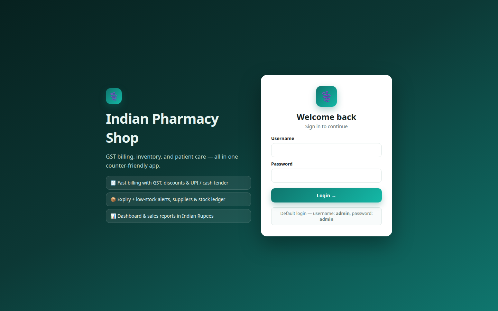
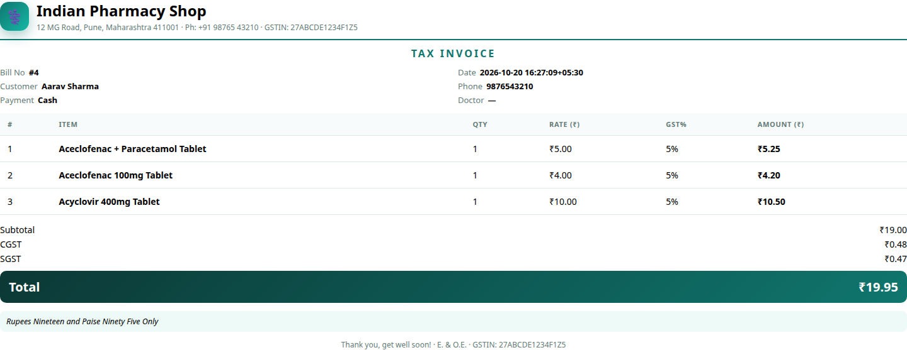

# Indian Pharmacy Shop — Standalone

Counter-friendly pharmacy billing, inventory, and GST invoicing for a single
store. React + Vite frontend, Flask + SQLAlchemy backend, SQLite database, and a
multi-stage Docker image for one-command deployment.

[](https://github.com/vipulverulkar/Indian-Pharmacy-Shop-Standalone/actions/workflows/ci.yml)
[](https://www.gnu.org/licenses/gpl-3.0)

| Login | Dashboard |
|---|---|
|  |  |

| Billing | Inventory |
|---|---|
|  |  |

| Reports | Invoice |
|---|---|
|  |  |

## Documentation

- [User manual](doc/USER_MANUAL.md) — screen-by-screen guide to billing, inventory,
  returns, reports, masters, users, and daily closing.
- [Installation manual](doc/INSTALLATION.md) — local, Windows, Docker, EXE, upgrades,
  backups, troubleshooting.
- [Architecture](doc/ARCHITECTURE.md) — components, data model, auth, API modules,
  deployment and CI/CD design.

## Features

- **Billing** — name/salt/batch search, stock-capped quantities, per-line
  rates, bill-level discount, payment modes, cash-tendered change calculator,
  printable GST invoice with amount in words.
- **Inventory** — add/edit/remove medicines, stock adjustments with an audit
  ledger, low/out-of-stock, expiring/expired and prescription-drug filters,
  sorting, suppliers, and purchase/stock-in entries.
- **Server-side pagination** — medicines and bills stay fast with large
  catalogues.
- **Masters** — GST slabs, medicine types, payment modes, store profile with
  name, address, GSTIN, logo, and low-stock threshold.
- **Users and roles** — admin (everything) and staff (billing plus read-only
  inventory), hashed passwords, 12-hour bearer sessions.
- **Dashboard and reports** — today's sales, stock value, low/expired alerts,
  top sellers, and sales reports.
- **One-command deployment** — Docker image serves API and UI from one process
  with persistent data volumes.
- **Standalone Windows EXE** — a single PyInstaller executable with the UI and
  backend bundled; no Python or Node.js on the target machine.

## Quick start

Requirements: Python 3.10+ for the backend, Node.js 26+ when building the UI.
Default login: `admin` / `admin`. Change it immediately after first login.

### Docker (recommended)

```bash
git clone https://github.com/vipulverulkar/Indian-Pharmacy-Shop-Standalone.git
cd Indian-Pharmacy-Shop-Standalone
docker compose up -d --build
```

Open <http://localhost:5000>. If port 5000 is busy:

```bash
HOST_PORT=5001 docker compose up -d --build
```

Prebuilt images are published to Docker Hub and GHCR:

```bash
docker pull vipulverulkar/indian-pharmacy-shop-standalone:latest
docker pull ghcr.io/vipulverulkar/indian-pharmacy-shop-standalone:latest
```

### Windows

Double-click `start.bat`; it installs dependencies, builds the UI, and opens the
app. Optional port argument: `start.bat 5001`.

### Windows executable

Download `IndianPharmacyShop-windows.zip` from the latest **Build Windows EXE**
workflow run, extract it, and double-click `IndianPharmacyShop.exe`. No Python or
Node.js is required on the target machine. To build locally on Windows, run
`build_windows.bat`; the output is `dist\IndianPharmacyShop.exe`.

The EXE stores its database and uploads in
`%LOCALAPPDATA%\IndianPharmacyShop`. Set `PHARMACY_DATA_DIR` to use a different
folder. Close the console window to stop the server.

### Linux / macOS

```bash
python3 -m venv .venv
source .venv/bin/activate
pip install -r backend/requirements.txt

cd frontend && npm ci && npm run build && cd ..
cd backend && python serve.py
```

Open <http://127.0.0.1:5000>. For development with hot reload, run
`python app.py` and `npm run dev` in separate terminals.

See [doc/INSTALLATION.md](doc/INSTALLATION.md) for all options, configuration,
PostgreSQL notes, backups, and troubleshooting.

## Configuration

| Variable | Default | Purpose |
|---|---|---|
| `HOST` | `0.0.0.0` | Bind address for the production server |
| `PORT` | `5000` | HTTP port |
| `ADMIN_USER` / `ADMIN_PASS` | `admin` / `admin` | Seeded admin login (first run only) |
| `SESSION_HOURS` | `12` | Bearer-token lifetime |
| `DATABASE_URL` | `backend/pharmacy.db` | SQLAlchemy database URL |

Example:

```bash
ADMIN_USER=owner ADMIN_PASS='change-me' SESSION_HOURS=8 PORT=5001 python serve.py
```

## Development

```bash
# Backend
pip install -r backend/requirements.txt
pip install ruff pytest
ruff check backend
python -m compileall -q backend
python -m pytest -q

# Frontend
cd frontend
npm ci
npm run build
npm run dev        # http://127.0.0.1:5173, proxies /api to :5000
```

### Tests and container checks

```bash
docker build -t pharmacy-app .
docker run -d --name pharmacy-test -p 5000:5000 pharmacy-app
curl http://127.0.0.1:5000/api/health
docker rm -f pharmacy-test
```

## CI/CD

- [`.github/workflows/ci.yml`](.github/workflows/ci.yml) — backend lint/compile/tests, frontend build, Docker build, and container health check on pull requests and `main`.
- [`.github/workflows/cd.yml`](.github/workflows/cd.yml) — multi-arch image push to GHCR on `main` and tags; builds Windows & Linux standalone EXEs; on `v*` tags creates a GitHub Release with frontend bundle, Windows EXE, and Linux EXE.

### Latest artifacts

| Artifact | Link |
|---|---|
| Docker image (GHCR) | <https://github.com/vipulverulkar/Indian-Pharmacy-Shop-Standalone/pkgs/container/indian-pharmacy-shop-standalone> |
| Windows EXE | <https://github.com/vipulverulkar/Indian-Pharmacy-Shop-Standalone/actions/workflows/cd.yml> (download from latest run) |
| Linux EXE | <https://github.com/vipulverulkar/Indian-Pharmacy-Shop-Standalone/actions/workflows/cd.yml> (download from latest run) |
| GitHub Releases (tagged) | <https://github.com/vipulverulkar/Indian-Pharmacy-Shop-Standalone/releases/latest> |

The published image is
`ghcr.io/vipulverulkar/indian-pharmacy-shop-standalone`.

Create a release:

```bash
git tag v1.0.0
git push origin v1.0.0
```

## API overview

All `/api/medicines` and `/api/bills` endpoints require
`Authorization: Bearer <token>`; writes require admin unless noted.

**Medicines**

- `GET /api/medicines?search=&unit=&stock=&sort=&page=1&per_page=20`
- `POST /api/medicines`, `PUT/DELETE /api/medicines/:id` (admin)
- `POST /api/medicines/:id/adjust` — stock correction (admin)

**Billing**

- `POST /api/bills` — `{customer_name, customer_phone, doctor_name,
  prescription_no, discount_percent, payment_mode, items:[{medicine_id, qty}]}`
- `GET /api/bills?page=1&per_page=10&search=&status=&from=&to=`
- `GET /api/bills/:id`, `POST /api/bills/:id/return`

**Masters, users, and reporting**

- `GET/POST/PUT/DELETE /api/gst-rates`, `/api/unit-types`, `/api/payment-modes`
- `GET /api/settings`, `PUT /api/settings`, `POST/DELETE /api/settings/logo`
- `GET/POST/DELETE /api/users`, `POST /api/change-password`
- `GET /api/dashboard`, `GET /api/reports/sales?days=14`
- `GET /api/suppliers`, `POST /api/purchases`, `GET /api/stock-movements`,
  `GET /api/customers`

Health check: `GET /api/health`.

Billing model: `quantity` is units in stock, `price` is the per-unit price in
INR, and `unit` is tablet/capsule/sachet/strip/bottle/syrup/injection/tube.

## Project structure

```text
backend/              Flask API, models, migrations, waitress entrypoint
frontend/             React source and Vite build output
tests/                Backend API and billing regression tests
launcher.py           Desktop entrypoint for the packaged executable
pharmacy.spec         PyInstaller build specification
build_windows.bat     Local Windows EXE build script
doc/screenshots/      README images
doc/ARCHITECTURE.md   Design and data model
doc/INSTALLATION.md   Installation and operations manual
doc/USER_MANUAL.md    Day-to-day user guide
.github/workflows/    CI, publish, and EXE build pipelines
Dockerfile            Node build stage + Python runtime stage
docker-compose.yml    One-command run with persistent volumes
ruff.toml             Backend lint configuration
start.bat             Windows launcher
run.sh                Linux/macOS launcher
```

## Data and backups

Data lives in `backend/pharmacy.db`; uploaded logos live in
`backend/uploads/`. Docker deployments use the `pharmacy-data` and
`pharmacy-uploads` volumes. Stop the app before copying the SQLite file, or use
the backup commands in [doc/INSTALLATION.md](doc/INSTALLATION.md).

## License

This project is licensed under the GNU General Public License v3.0 (GPL-3.0-or-later).
See [LICENSE](LICENSE) for the full license text.

In summary:
- You may freely use, modify, and distribute this software
- You must include the license and copyright notice in all copies
- You must make source code available to recipients
- Modified versions must carry prominent notices of changes
- No warranty is provided
