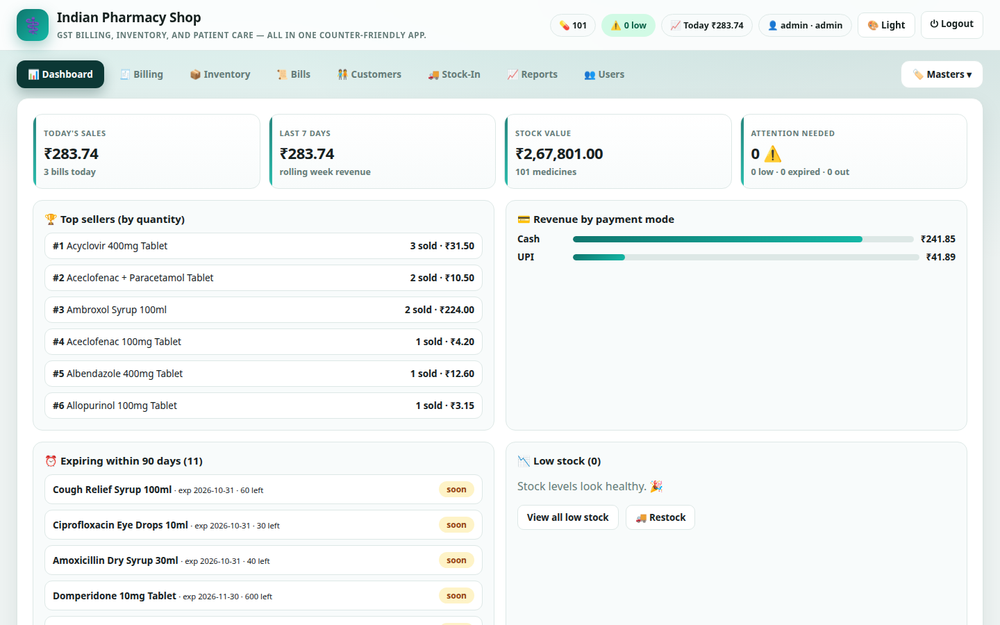
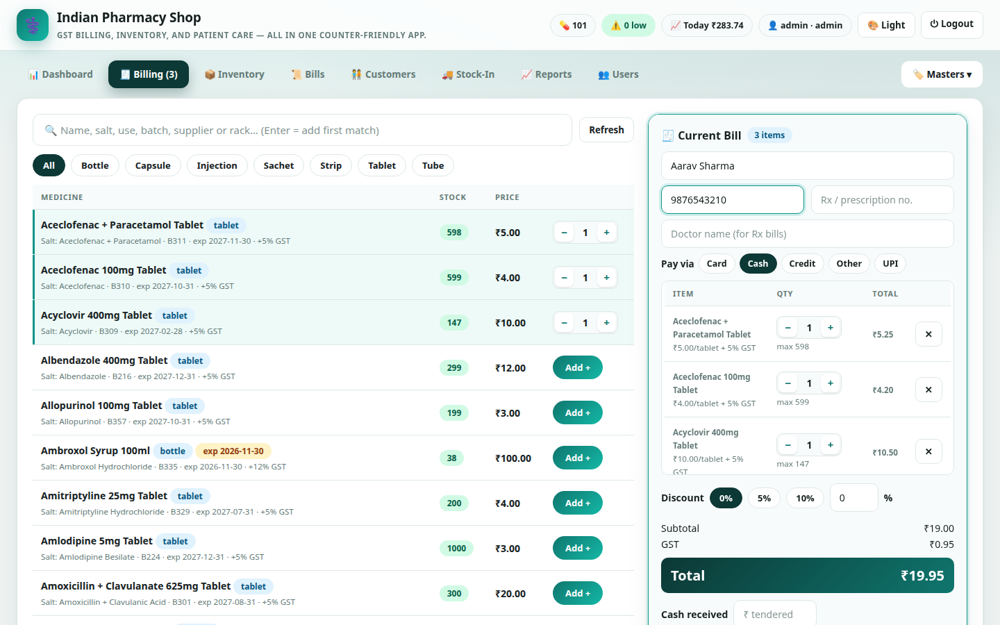
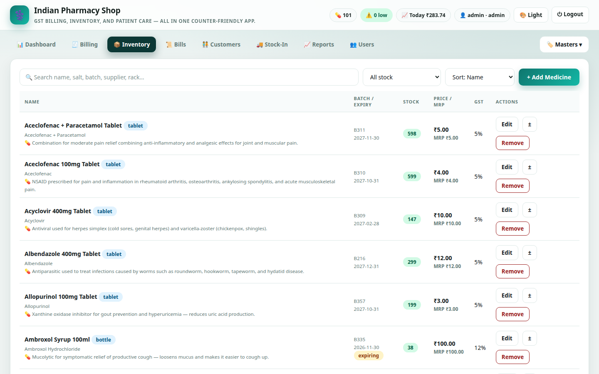
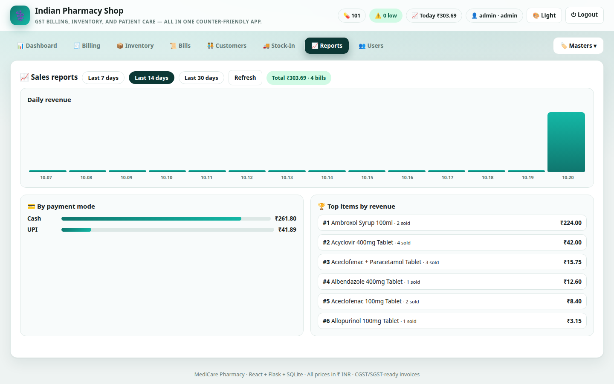

# User Manual

Indian Pharmacy Shop — Standalone is a counter-friendly billing, inventory, and
GST invoicing application for a single pharmacy. This manual explains every
screen and the daily workflow for admins and staff.

> Screenshots use demo data. They do not contain real customer information.

## Contents

1. [Getting started](#1-getting-started)
2. [Dashboard](#2-dashboard)
3. [Billing](#3-billing)
4. [Invoices and returns](#4-invoices-and-returns)
5. [Inventory](#5-inventory)
6. [Bills](#6-bills)
7. [Customers](#7-customers)
8. [Stock-In and suppliers](#8-stock-in-and-suppliers)
9. [Reports](#9-reports)
10. [Masters and store profile](#10-masters-and-store-profile)
11. [Users, roles, and passwords](#11-users-roles-and-passwords)
12. [Daily closing checklist](#12-daily-closing-checklist)
13. [Keyboard and workflow tips](#13-keyboard-and-workflow-tips)
14. [Troubleshooting](#14-troubleshooting)
15. [Glossary](#15-glossary)

## 1. Getting started

### Log in

Open the app at `http://127.0.0.1:5000` (or the address shown by your launcher)
and sign in.

- Default username: `admin`
- Default password: `admin`

Change the password immediately after the first login. See
[Users, roles, and passwords](#11-users-roles-and-passwords).

### Roles

| Role | Can do |
|---|---|
| **Admin** | Everything: billing, inventory, returns, purchases, reports, masters, users, store profile |
| **Staff** | Billing, viewing bills/customers/reports, viewing inventory and stock movements |

Admin-only buttons are hidden for staff. The server also enforces permissions,
so a staff account cannot change protected data even with a crafted request.

### Navigation

The top navigation contains Dashboard, Billing, Inventory, Bills, Customers,
Stock-In, Reports, and Users (or Account for staff). Admins also have a
**Masters** menu with GST Rates, Medicine Types, Payment Modes, and Store
Profile.

The header shows the medicine count, low-stock count, today's sales, the signed-in
user, the theme selector, and Logout.

## 2. Dashboard

The dashboard is the home screen after login.

- **Today's sales** and today's bill count.
- **Last 7 days** rolling revenue.
- **Stock value** at selling price and total medicine count.
- **Attention needed** for low stock, expired items, and out-of-stock items.
- **Top sellers** by quantity.
- **Revenue by payment mode**.
- **Expiring within 90 days** and **Low stock** panels with direct links to the
  filtered inventory.
- **Today's bills** with the latest transactions.

Use **View all low stock** or **Restock** to jump to inventory. The dashboard
refreshes when you open it and after billing, returns, and stock changes.

## 3. Billing

The Billing tab is the main checkout screen.

### Find a medicine

Use the search box to match name, salt/composition, batch, supplier, or rack.

- Press **Enter** to add the first matching in-stock medicine to the bill.
- Use the unit filters (All, Bottle, Capsule, Injection, Sachet, Strip, Tablet,
  Tube) to narrow the list.
- The table shows stock, selling price, batch, expiry, GST, and rack.

### Build the bill

1. Click **Add +** on a medicine, or press Enter in search.
2. Adjust quantity with the **−** and **+** steppers. Quantity is capped at the
   available stock.
3. Fill in customer details:
   - **Customer name** is optional but recommended; it feeds the customer ledger.
   - **Phone** enables repeat-customer lookup and history.
   - **Doctor name** and **Rx / prescription no.** are optional and appear on the
     invoice.
4. Choose a **payment mode** (Cash, UPI, Card, Credit, Other by default).
5. Choose a **discount** of 0%, 5%, 10%, or type a custom percentage.
6. Enter **Cash received** to see the change due. The app warns if the amount is
   short.
7. Click **Bill ₹…** to complete the sale.

Completing a bill:

- Decrements stock for every line.
- Calculates GST per line and the bill total.
- Records a stock movement with reason `sale`.
- Updates the customer ledger.
- Shows the printable invoice immediately.

The cart is cleared after checkout. The invoice stays visible until you start a
new bill.

### Prescription medicines

Medicines marked **℞** require a prescription. The invoice can show the
prescription number and doctor. Verify the physical prescription before
dispensing, as required by your local regulations.

### Stock and expiry guards

- You cannot add more than the available stock.
- Expired medicines cannot be added from the billing list.
- If stock changes while you are billing, checkout revalidates and rejects the
  bill with a clear error.

## 4. Invoices and returns

The invoice is a GST **TAX INVOICE** with:

- Store name, address, phone, GSTIN, and logo.
- Bill number, date, customer, phone, payment mode, doctor, and prescription.
- Item lines with quantity, rate, GST %, and line amount.
- Subtotal, CGST, SGST, discount, grand total, and amount in words.
- A print-friendly layout with navigation and buttons hidden.

### Print or save as PDF

Open the invoice and click **🖨 Print Invoice**. In the browser print dialog,
choose a printer or **Save as PDF**. The printed page uses the dedicated print
stylesheet.

### Returns

To accept a full return:

1. Open **Bills**.
2. Find the bill and click **View**.
3. Click **↩ Accept return (restock)** and confirm.
4. Stock is restored for every line, a `return` stock movement is recorded, and
   the bill is marked **returned**.

The current version supports full returns only, not partial line returns.

## 5. Inventory

The Inventory tab lists medicines with batch, expiry, stock, price, MRP, GST,
and actions.

### Filters and sorting

- Search by name, salt, batch, supplier, or rack.
- **Stock filter:** All, Low stock, Out of stock, Expiring ≤ 90 days, Expired,
  Prescription drugs.
- **Sort:** Name, Lowest stock, Expiry, or Stock value.
- Pagination keeps large catalogues fast.

### Add a medicine (admin)

Click **+ Add Medicine** and fill in:

| Field | Notes |
|---|---|
| Medicine name | Required |
| Composition / salt | Generic composition for search |
| Description | What the medicine treats |
| Usage | Dose instructions printed on the invoice |
| Medicine type | Tablet, capsule, bottle, etc. from active masters |
| Batch no / Expiry date | For recall and expiry tracking |
| Rack / shelf | Physical location |
| Stock quantity | Units currently available |
| Min stock alert | Low-stock threshold for this item |
| Selling price / MRP | Per-unit price in INR |
| GST slab | Must be an active master slab |
| Schedule | H, H1, X, or blank |
| Supplier | Distributor name |
| Prescription required | Marks the item ℞ |

### Edit or remove

- **Edit** updates the medicine details and price.
- **Remove** deletes the medicine after confirmation. Historical bills keep
  their item names and totals.
- Prefer deactivating masters instead of deleting values that are in use.

### Adjust stock (admin)

Click **±** on a row to correct stock without a sale or purchase:

- Enter a positive number to add stock, or a negative number to remove it.
- Give a reason such as `breakage`, `recount`, `expiry write-off`, or `theft`.
- The adjustment is written to the stock movement audit trail.

Use **Stock-In** for normal supplier purchases instead of manual adjustments.

## 6. Bills

The Bills tab lists transactions with server-side pagination.

- Search by bill number, customer, or phone.
- Filter by status: All, Completed, Returned.
- Filter by date range or use **Today** / **Last 7 days**.
- Click **View** to open the invoice and return action.

Bills cannot be edited after checkout. Use a return and re-bill if a correction
is needed.

## 7. Customers

Customers are created automatically from bills that include a name or phone.

- Search by name or phone.
- See bill count, lifetime spend, and last visit.
- Click **History** to view the customer's bills.

Use unique phone numbers at the counter to avoid duplicate customer records.
Bills without a name or phone are not linked to a customer.

## 8. Stock-In and suppliers

### Record a purchase (admin)

1. Open **Stock-In**.
2. Type at least two characters of the medicine name and select the match.
3. Enter the quantity received.
4. Enter the supplier and an optional invoice/note.
5. Click **➕ Add stock**.

Stock increases immediately and a `purchase` movement is recorded. The purchase
is not a payable invoice; use your accounting system for supplier ledgers.

### Stock movements

The right side of the screen shows recent movements: sales, purchases, returns,
and adjustments, with the user and timestamp. Use it to investigate shrinkage or
reconcile stock.

### Suppliers (admin)

Add, edit, or remove suppliers with name, phone, address, and GSTIN. Supplier
names are suggested in the medicine and stock-in forms.

## 9. Reports

The Reports tab shows sales performance.

- Switch between **Last 7 days**, **Last 14 days**, and **Last 30 days**.
- **Daily revenue** bar chart.
- **Revenue by payment mode**.
- **Top items by revenue**.
- Total revenue and bill count for the selected period.

Returned bills are excluded from sales totals. Use the Dashboard for today's
snapshot and Reports for longer trends.

## 10. Masters and store profile

Admins manage shared values under **Masters**. Medicines and bills validate
against active values.

### GST Rates

Add or edit slabs such as 5%, 12%, and 18%. Only active slabs can be selected for
medicines. Deactivate a slab instead of deleting it if historical data uses it.

### Medicine Types

Manage units such as tablet, capsule, bottle, strip, sachet, syrup, injection,
and tube. These appear in the medicine form and billing filters.

### Payment Modes

Manage Cash, UPI, Card, Credit, Other, or your own modes. Only active modes can
be used for new bills. Historical bills keep their recorded mode.

### Store Profile

Set the name, tagline, address, phone, GSTIN, low-stock limit, and logo used on
the login screen, header, and invoices.

- Use a square or horizontal logo, ideally under 2 MB.
- Allowed formats: PNG, JPG/JPEG, GIF, WEBP, SVG.
- The GSTIN is validated before saving.

## 11. Users, roles, and passwords

Admins can manage logins under **Users**.

### Create a user

1. Open **Users**.
2. Enter a username and password.
3. Leave **Admin** unchecked for counter staff.
4. Click **Create user**.

### Remove a user

Click **Remove** next to the account. You cannot remove the account you are
currently signed in with.

### Change your password

Open **Users** (admin) or **Account** (staff) and use the password form:

1. Enter the current password.
2. Enter the new password twice.
3. Submit. You stay signed in.

Passwords are stored as Werkzeug hashes, never in plain text.

### Sessions

- Sessions last 12 hours by default (`SESSION_HOURS`).
- Sessions are held in memory; restarting the server logs everyone out.
- Log out before leaving a shared counter.

## 12. Daily closing checklist

At the end of the day:

1. Complete or clear any open bill in the Billing tab.
2. Open **Dashboard** and note today's sales and bill count.
3. Open **Bills**, filter to **Today**, and reconcile payment modes against cash,
   UPI, and card settlements.
4. Review **Low stock**, **Out of stock**, and **Expiring** filters.
5. Record stock-in entries for deliveries received during the day.
6. Accept returns for any customer returns, if applicable.
7. Back up the database. See the backup section in [INSTALLATION.md](INSTALLATION.md).

## 13. Keyboard and workflow tips

- Press **Enter** in the billing search box to add the first matching medicine.
- Use the unit filters to avoid scrolling through unrelated items.
- Add a customer phone number to build repeat-customer history.
- Use the **±** adjustment with a reason for breakage or expiry write-offs; avoid
  editing stock directly for normal deliveries.
- Use **Reload/Refresh** if another counter or user changed data in a different
  browser tab.
- Use the theme selector in the header for a lighter or darker counter display.
  The choice is saved per browser.
- The app is designed for one store and one server process. Do not open the same
  SQLite file from multiple machines.

## 14. Troubleshooting

| Problem | Fix |
|---|---|
| Login fails | Check the username/password. Default is `admin` / `admin` until changed. |
| "Login required" after a server restart | Sessions are in memory; log in again. |
| "Insufficient stock" at checkout | Refresh the medicine list; another bill may have consumed stock. |
| GST / unit / payment validation error | Add or activate the value under **Masters**. |
| Invoice looks wrong | Check **Store Profile** for name, address, GSTIN, and logo. |
| Customer history is missing | Bills need a customer name or phone to create a ledger entry. |
| Stock does not match shelves | Check **Stock-In → Recent stock movements** and use **±** with a reason. |
| Page is blank after an update | Rebuild the UI or refresh; see [INSTALLATION.md](INSTALLATION.md). |
| Cannot print | Allow pop-ups/printing for the app and use the browser print dialog. |
| Data lost after restart | The database is a file; confirm `DATABASE_URL` / `PHARMACY_DATA_DIR` points to the same location. |
| EXE blocked by SmartScreen | The executable is unsigned; allow it or build/sign your own. |

## 15. Glossary

| Term | Meaning |
|---|---|
| **GST** | Goods and Services Tax; the invoice splits it into CGST and SGST. |
| **GSTIN** | GST identification number printed on invoices. |
| **MRP** | Maximum retail price; shown for customer savings comparison. |
| **Batch** | Supplier batch/lot number used for recalls and expiry tracking. |
| **Expiry** | Date after which stock must not be sold. Expired items are blocked in billing. |
| **Schedule H / H1 / X** | Regulatory schedules for restricted medicines. |
| **Rx / ℞** | Prescription required. |
| **Stock movement** | Audit entry for a sale, purchase, return, or adjustment. |
| **Returned bill** | A completed bill that was fully reversed; excluded from sales totals. |
| **Low stock** | Quantity at or below the store limit or the medicine's minimum stock. |
